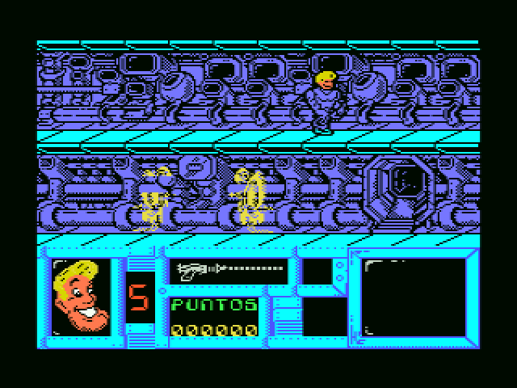
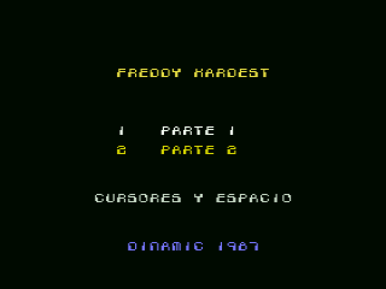
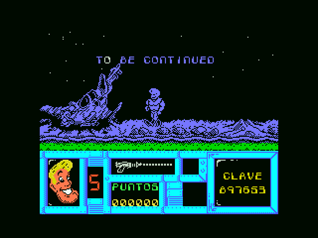
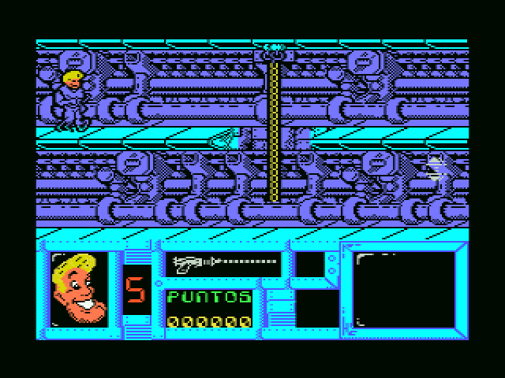
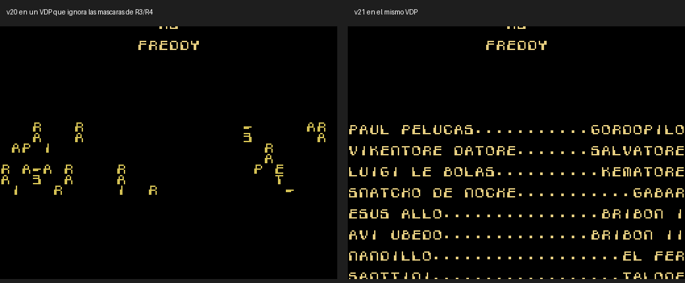

# Freddy Hardest Enhanced (MSX1)

[Español](README.md) · **English** · [日本語](README.ja.md)

An enhanced cartridge version of **Freddy Hardest** (Dinamic Software, 1987) for MSX1. Both parts of the tape fit in a single MegaROM. The game now runs faster and has more colour: Freddy's hair and face are sprites, the enemies are coloured sprites and the scoreboard has been repainted. Several bugs of the original are also fixed.



## What's new

* **256 KB MegaROM cartridge (ASCII16)**. openMSX and BlueMSX detect it automatically. It needs an MSX1 with 64 KB of RAM, like the tape.
* **New start-up**: original loading screen, intro (any key skips it) and a "1 PARTE 1 / 2 PARTE 2" menu. Part 1 goes straight into the game menu. Part 2 still asks for the code, which is given at the end of part 1.
* **Faster**: the game draws into a Spectrum-style buffer and used to copy all of it to the screen every frame. Now only the cells that change are sent. With the limiter, part 1 runs at 11 frames per second and part 2 at 15. The original ran at 6-8 in part 1 and 9-12 in part 2.
* **Colour with sprites**: Freddy's head and blond hair are sprites, and his body keeps the original drawing with a fixed blue ink in the play area. The enemies are coloured sprites too. In part 2 the guard is green, the robot yellow and the mine grey. The sprites take turns so no enemy stays hidden for many frames in a row.
* **Coloured scoreboard** with Freddy's face (hair and eye whites as fixed sprites), and new background **stars** in part 1.
* **Sound effects on the PSG** in part 1. The original made them with the keyboard click and stopped the game while they played: the explosion froze it for 107 ms.
* **Keyboard**: no short key press is lost. Default keys are the cursors and SPACE. The joystick still works and the keys can be redefined in the game menu.
* **Bugs of the original fixed**:
  * The shot went through enemies very close to Freddy, and through the flying enemy when Freddy was high up.
  * The letters of the part 1 ending message came out broken.
  * When changing rooms, the sprites of the previous room stayed for a few frames. Now they are removed just as the new room starts to be drawn, also when going up or down in the lift.
  * In part 2, the shot bar showed full after changing rooms even when it was empty.
* **Part 1 ending** with "TO BE CONTINUED" and the part 2 code on the scoreboard monitor.
* **Hidden credits restored**: Dinamic left a "movie-style" cast list disabled. It now plays at the end of part 2, with the intro music.

| | |
|---|---|
|  |  |
|  |  |

## Downloads

In [`releases/`](releases/):

| File | What it is |
|---|---|
| `FreddyHardest_Enhanced_v1.0.rom` | 256 KB ROM, ASCII16 MegaROM, for MSX1 or later with 64 KB of RAM. SHA-1 `98c78772f7429b0cf38b1c8ea9f941cfc89659b2`. |

Tested in openMSX with C-BIOS MSX1 and Sony HB-20P, and played by a group of testers.

## How to build

You need **Python 3** with **Pillow**, and **pasmo** (the published ROM was built with pasmo 0.5.3; if sjasmplus is on the PATH it is used instead, and it has not been checked to give the same ROM). The repository contains nothing from the original game: the game is taken from **your own tapes** (both sides of the Spanish release as `.cas`), and the intro state from the ROM in `releases/`.

```sh
# 1. Extract the originals from your tapes (their MD5 is checked) and the intro state from the ROM
python3 tools/extrae_originales.py sideA.cas sideB.cas

# 2. Build: gives the same ROM as releases/ (the SHA-1 is checked)
python3 tools/hacer_rom.py                 # -> FreddyHardest_Enhanced.rom
python3 tools/hacer_rom.py --sin-limite    # no limiter: as fast as it can go
```

## What's in the repository

| Folder | Contents |
|---|---|
| `src/` | The new code. `optim.asm` does the dirty-cell screen update and the limiter. `spr_a.asm` handles the sprites and the coloured scoreboard (both parts). `estrellas.asm`, `limita.asm`, `cambia.asm`, `creditos.asm`, `arranque.asm` and `copiador.asm` complete the cartridge. `build_rom.py` puts the ROM together. |
| `src/graficos/` | Freddy sheets with the retouched hair and coloured scoreboard. The sprite conversion is cached in `*_cache.json` files, rebuilt at build time. |
| `tools/` | Extraction of the originals and full build. |
| `openmsx/` | Test scripts for openMSX (VRAM access, room changes, shot bar, start-up). |
| `docs/` | Technical documentation and lessons, in [Spanish](docs/es/), [English](docs/en/) and [Japanese](docs/ja/). |
| `images/` | Screenshots. |
| `releases/` | The built ROM. |

## Documentation

* [Technical documentation](docs/en/DOCUMENTATION.md): memory, hooks, sprites, each improvement and its history.
* [Lessons](docs/en/LESSONS.md): what was learned, useful for other MSX games.

## Credits

* **Freddy Hardest** (1987): Dinamic Software. Program: Emilio Salgueiro and Pedro Sudón. Loading screen: J. Cubedo. Music: Manuel Cubedo. Effects: Luis Rodríguez. These are the credits given by the game itself.
* **Freddy Hardest Enhanced** (2026): direction, testing and graphic retouches (Freddy's hair, stars, colours), araubi. Ideas by Néstor Sancho (scoreboard colours, fixed stars). Thanks to the group of testers.
* Reverse engineering, code and documentation: developed with Claude (Anthropic).

## Licence and notices

* **Own code and tools** (`src/`, `tools/`, `openmsx/`): MIT licence, see [LICENSE](LICENSE).
* **Own documentation and graphic retouches** (`docs/`, the READMEs, `src/graficos/`): CC BY-NC-SA 4.0, see [LICENSE-CC](LICENSE-CC). Retouches over game graphics only cover the retouch.
* **The original game is not covered by these licences.** Freddy Hardest, its code, graphics, music, texts and cover art belong to their authors and rights holders. The screenshots in `images/` show the game and are not covered either. The ROM in `releases/` contains the modified original game and is not covered by the licences above.
* This is a non-profit tribute. No original file is included (tapes, ROMs or dumps). It will be taken down if any rights holder asks.
