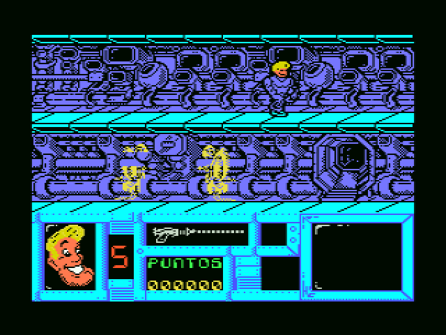
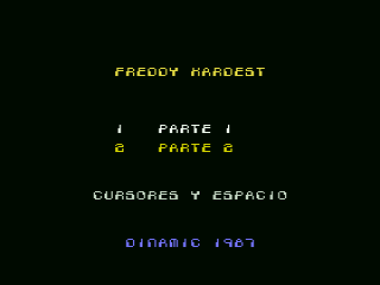
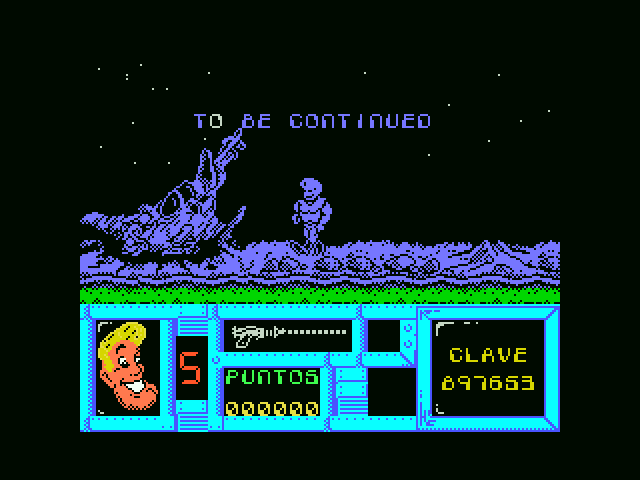
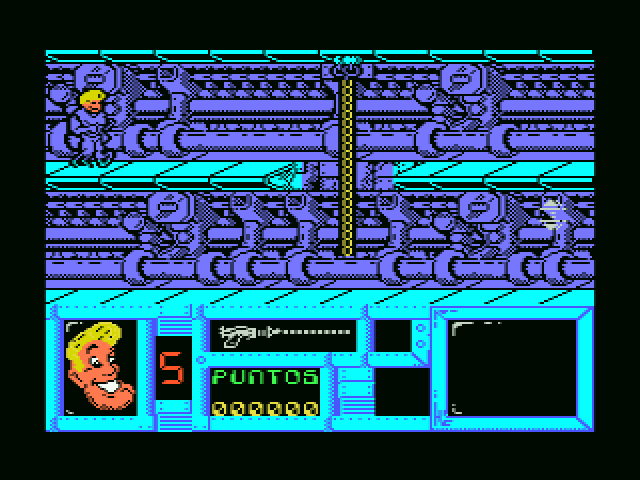
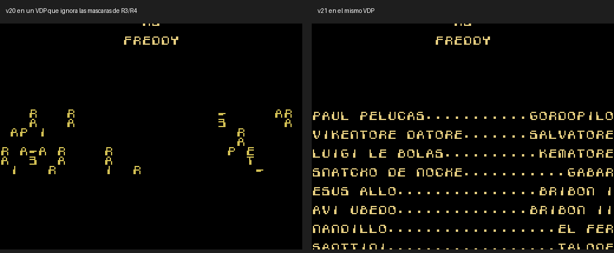

# Freddy Hardest Enhanced (MSX1)

[Español](README.md) · [English](README.en.md) · **日本語**

**Freddy Hardest**（Dinamic Software、1987 年）の MSX1 用カートリッジ強化版です。テープの 2 つのパートを 1 本のメガ ROM に収めました。動作が速くなり、色も増えています。フレディの髪と顔はスプライト、敵はカラーのスプライトになり、スコアボードも描き直しました。オリジナルのいくつかのバグも修正しています。



## 新しい点

* **256 KB のメガ ROM カートリッジ（ASCII16）**。openMSX と BlueMSX が自動で認識します。テープ版と同じく、RAM 64 KB の MSX1 が必要です。
* **新しい起動**：オリジナルのローディング画面、イントロ（キーを押すと飛ばせます）、「1 PARTE 1 / 2 PARTE 2」のメニュー。パート 1 はそのままゲームのメニューに入ります。パート 2 は今まで通りパスワードを聞きます。パスワードはパート 1 の最後に表示されます。
* **高速化**：このゲームはスペクトラム形式のバッファに描き、毎フレームそれを全部画面にコピーしていました。今は変化したセルだけを送ります。リミッター付きで、パート 1 は毎秒 11 フレーム、パート 2 は 15 フレームです。オリジナルはパート 1 が 6〜8、パート 2 が 9〜12 でした。
* **スプライトで色付け**：フレディの頭と金髪はスプライトで、体はオリジナルの絵のまま、プレイエリアは青の固定インクです。敵もカラーのスプライトです。パート 2 では警備員が緑、ロボットが黄、地雷が灰色です。スプライトは交代で表示するので、同じ敵が何フレームも続けて隠れることはありません。
* **カラーのスコアボード**：フレディの顔（髪と白目は固定スプライト）付き。パート 1 には新しい背景の**星**があります。
* **パート 1 の効果音を PSG で**：オリジナルはキークリックで音を出し、その間ゲームが止まっていました。爆発では 107 ms 止まっていました。
* **キーボード**：短いキー入力も取りこぼしません。標準のキーはカーソルとスペースです。ジョイスティックもそのまま使え、ゲームのメニューでキーを変更できます。
* **オリジナルのバグを修正**：
  * フレディのすぐ近くの敵と、フレディが高い所にいるときの飛行する敵を、弾がすり抜けていました。
  * パート 1 のエンディングの文字が崩れていました。
  * 部屋を移るとき、前の部屋のスプライトが数フレーム残っていました。今は新しい部屋を描き始めるちょうどその時に消します。エレベーターで上下するときも同じです。
  * パート 2 で、弾丸バーが空なのに部屋を移ると満タンに表示されていました。
* **パート 1 のエンディング**に「TO BE CONTINUED」と、スコアボードのモニターにパート 2 のパスワードを表示します。
* **隠しクレジットを復活**：Dinamic が無効にしていた「映画風」のスタッフロールが、パート 2 のクリア後にイントロの音楽とともに流れます。

| | |
|---|---|
|  |  |
|  |  |

## ダウンロード

[`releases/`](releases/) にあります：

| ファイル | 内容 |
|---|---|
| `FreddyHardest_Enhanced_v1.0.rom` | 256 KB の ROM、ASCII16 メガ ROM。RAM 64 KB 以上の MSX1 以降用。SHA-1 `98c78772f7429b0cf38b1c8ea9f941cfc89659b2`。 |

openMSX の C-BIOS MSX1 と Sony HB-20P で確認し、テスターのグループにも遊んでもらいました。

## ビルド方法

**Python 3**（**Pillow** 付き）と **pasmo** が必要です（公開した ROM は pasmo 0.5.3 でビルドしました。PATH に sjasmplus があればそちらを使いますが、同じ ROM になるかは確認していません）。このリポジトリにはオリジナルのゲームは何も入っていません。ゲームは**手持ちのテープ**（スペイン版の両面、`.cas` 形式）から、イントロの状態は `releases/` の ROM から取り出します。

```sh
# 1. テープからオリジナルを（MD5 を確認して）、ROM からイントロの状態を取り出す
python3 tools/extrae_originales.py sideA.cas sideB.cas

# 2. ビルド：releases/ と同じ ROM ができます（SHA-1 を確認）
python3 tools/hacer_rom.py                 # -> FreddyHardest_Enhanced.rom
python3 tools/hacer_rom.py --sin-limite    # リミッターなし：できるだけ速く
```

## リポジトリの内容

| フォルダー | 内容 |
|---|---|
| `src/` | 新しいコード。`optim.asm` は変化したセルだけの画面転送とリミッター、`spr_a.asm` はスプライトとカラーのスコアボード（両パート）。`estrellas.asm`、`limita.asm`、`cambia.asm`、`creditos.asm`、`arranque.asm`、`copiador.asm` でカートリッジを仕上げ、`build_rom.py` が ROM を組み立てます。 |
| `src/graficos/` | 髪を修正したフレディのシートとカラーのスコアボード。スプライト変換のキャッシュ（`*_cache.json`）はビルド時に作り直します。 |
| `tools/` | オリジナルの取り出しとビルド一式。 |
| `openmsx/` | openMSX 用のテストスクリプト（VRAM アクセス、部屋の切り替え、弾丸バー、起動）。 |
| `docs/` | 技術文書と教訓。[スペイン語](docs/es/)、[英語](docs/en/)、[日本語](docs/ja/)。 |
| `images/` | 画面写真。 |
| `releases/` | ビルド済みの ROM。 |

## 文書

* [技術文書](docs/ja/DOCUMENTATION.md)：メモリ、フック、スプライト、各改良とその経緯。
* [教訓](docs/ja/LESSONS.md)：ほかの MSX ゲームにも役立つ知見。

## クレジット

* **Freddy Hardest**（1987 年）：Dinamic Software。プログラム：Emilio Salgueiro、Pedro Sudón。ローディング画面：J. Cubedo。音楽：Manuel Cubedo。効果音：Luis Rodríguez。ゲーム自体に記されたクレジットです。
* **Freddy Hardest Enhanced**（2026 年）：監修、テスト、グラフィックの修正（フレディの髪、星、色）は araubi。Néstor Sancho のアイデア（スコアボードの色、固定の星）。テスターの皆さんに感謝します。
* リバースエンジニアリング、コード、文書：Claude（Anthropic）とともに開発。

## ライセンスと注意

* **独自のコードとツール**（`src/`、`tools/`、`openmsx/`）：MIT ライセンス。[LICENSE](LICENSE) を参照。
* **独自の文書とグラフィックの修正**（`docs/`、README、`src/graficos/`）：CC BY-NC-SA 4.0。[LICENSE-CC](LICENSE-CC) を参照。ゲームのグラフィックへの修正は、修正部分だけが対象です。
* **オリジナルのゲームはこれらのライセンスの対象外です。** Freddy Hardest のコード、グラフィック、音楽、テキスト、パッケージイラストは作者と権利者のものです。`images/` の画面写真もゲームを写したもので対象外です。`releases/` の ROM はオリジナルのゲームに手を加えたもので、上記のライセンスの対象外です。
* 非営利のオマージュです。オリジナルのファイル（テープ、ROM、ダンプ）は含みません。権利者から要請があれば公開を取り下げます。
