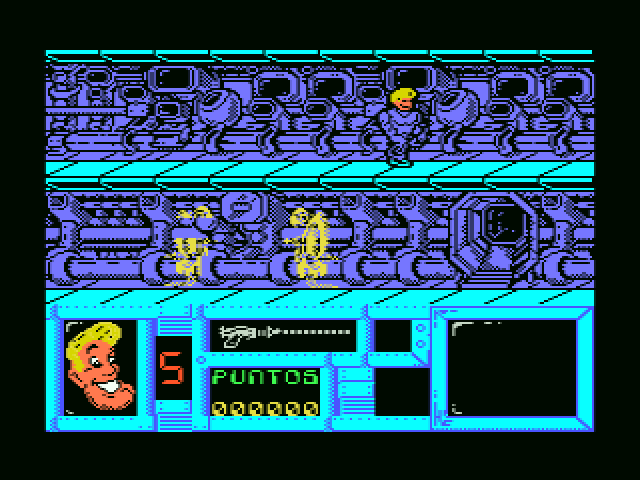
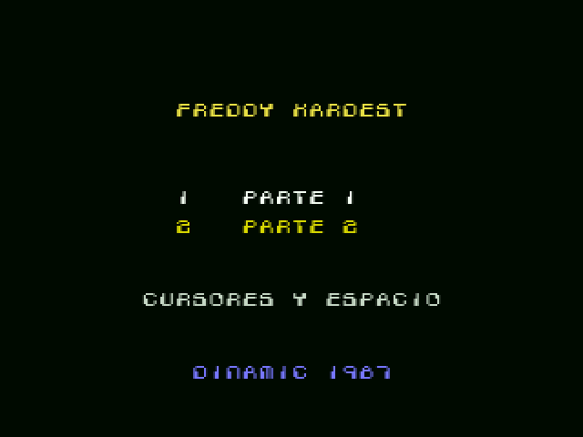
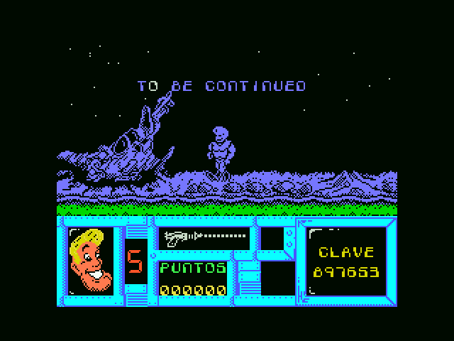
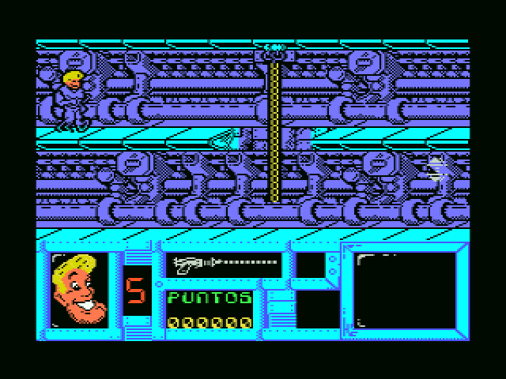
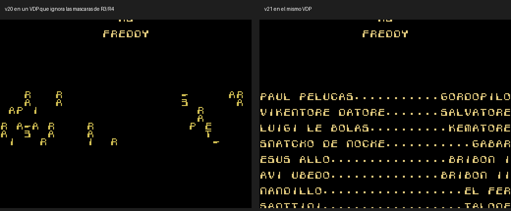

# Freddy Hardest Enhanced (MSX1)

**Español** · [English](README.en.md) · [日本語](README.ja.md)

Versión mejorada en cartucho de **Freddy Hardest** (Dinamic Software, 1987) para MSX1. Las dos partes de la cinta van en una sola MegaROM. Ahora el juego va más rápido y con más color: Freddy lleva el pelo y la cara en sprites, los enemigos van en sprites de color y el marcador está pintado de nuevo. También se han arreglado varios fallos del original.



## Qué tiene de nuevo

* **Cartucho MegaROM de 256 KB (ASCII16)**. openMSX y BlueMSX lo reconocen solos. Pide un MSX1 con 64 KB de RAM, como la cinta.
* **Arranque nuevo**: pantalla de carga original, presentación (se salta con una tecla) y menú «1 PARTE 1 / 2 PARTE 2». La parte 1 entra directamente en el menú del juego. La parte 2 sigue pidiendo la clave, que se da al terminar la parte 1.
* **Más rápido**: el juego dibuja en un búfer al estilo del Spectrum y lo copiaba entero a la pantalla en cada imagen. Ahora solo se mandan las celdas que cambian. Con el limitador, la parte 1 va a 11 imágenes por segundo y la parte 2 a 15. El original iba a 6-8 en la parte 1 y a 9-12 en la parte 2.
* **Color con sprites**: Freddy lleva la cabeza y el pelo rubio en sprites. El cuerpo sigue en el dibujo original, con una tinta azul fija en la zona de juego. Los enemigos también van en sprites de color. En la parte 2, el guardia es verde, el robot amarillo y la mina gris. El reparto de sprites se turna para que ningún enemigo se quede escondido muchas imágenes seguidas.
* **Marcador en color**, con la cara de Freddy (pelo y blanco de los ojos en sprites fijos), y **estrellas** de fondo nuevas en la parte 1.
* **Efectos de sonido por el PSG** en la parte 1. El original los hacía con el clic del teclado y paraba el juego mientras sonaban: la explosión lo congelaba 107 ms.
* **Teclado**: no se pierde ninguna pulsación corta. Teclas por defecto: cursores y ESPACIO. El joystick sigue valiendo y las teclas se pueden redefinir en el menú del juego.
* **Fallos del original arreglados**:
  * El disparo atravesaba a los enemigos muy pegados a Freddy y al volador cuando Freddy estaba en lo alto.
  * Las letras del mensaje final de la parte 1 salían rotas.
  * Al cambiar de sala quedaban unos fotogramas los sprites de la sala anterior. Ahora se quitan justo cuando empieza a pintarse la nueva, también al subir o bajar por el ascensor.
  * En la parte 2, la barra de disparos salía llena al cambiar de sala aunque estuviera vacía.
* **Final de la parte 1** con «TO BE CONTINUED» y la clave de la parte 2 en el monitor del marcador.
* **Créditos ocultos recuperados**: Dinamic dejó desactivado un reparto «de película». Ahora sale al terminar la parte 2, con la música de la presentación.

| | |
|---|---|
|  |  |
|  |  |

## Descargas

En [`releases/`](releases/):

| Fichero | Qué es |
|---|---|
| `FreddyHardest_Enhanced_v1.0.rom` | ROM de 256 KB, MegaROM ASCII16, para MSX1 o superior con 64 KB de RAM. SHA-1 `98c78772f7429b0cf38b1c8ea9f941cfc89659b2`. |

Se ha probado en openMSX con C-BIOS MSX1 y Sony HB-20P, y lo ha jugado un grupo de probadores.

## Cómo se compila

Hace falta **Python 3** con **Pillow**, y **pasmo** (la ROM publicada se compiló con pasmo 0.5.3; si sjasmplus está en el PATH se usa ese, y no se ha comprobado que dé la misma ROM). El repositorio no incluye nada del juego original: el juego se saca de **tus propias cintas** (las dos caras de la edición española en `.cas`), y el estado de la presentación, de la ROM de `releases/`.

```sh
# 1. Saca los originales de tus cintas (comprueba su MD5) y el estado de la presentación de la ROM
python3 tools/extrae_originales.py caraA.cas caraB.cas

# 2. Compila: da la misma ROM que releases/ (comprueba el SHA-1)
python3 tools/hacer_rom.py                 # -> FreddyHardest_Enhanced.rom
python3 tools/hacer_rom.py --sin-limite    # sin limitador: todo lo rápido que pueda
```

## Qué hay en el repositorio

| Carpeta | Contenido |
|---|---|
| `src/` | El código nuevo. `optim.asm` hace el volcado por celdas sucias y el limitador. `spr_a.asm` lleva los sprites y el marcador en color (las dos partes). `estrellas.asm`, `limita.asm`, `cambia.asm`, `creditos.asm`, `arranque.asm` y `copiador.asm` completan el cartucho. `build_rom.py` monta la ROM. |
| `src/graficos/` | Hojas de Freddy con el pelo retocado y marcador en color. La conversión a sprites se guarda en cachés `*_cache.json` que se rehacen al compilar. |
| `tools/` | Extracción de los originales y compilación completa. |
| `openmsx/` | Scripts de prueba para openMSX (accesos a la VRAM, cambios de sala, barra de disparos, arranque). |
| `docs/` | Documentación técnica y lecciones, en [español](docs/es/), [inglés](docs/en/) y [japonés](docs/ja/). |
| `images/` | Capturas. |
| `releases/` | La ROM compilada. |

## Documentación

* [Documentación técnica](docs/es/DOCUMENTACION.md): memoria, ganchos, sprites, cada mejora y su historia.
* [Lecciones](docs/es/LECCIONES.md): lo aprendido, útil para otros juegos de MSX.

## Créditos

* **Freddy Hardest** (1987): Dinamic Software. Programa: Emilio Salgueiro y Pedro Sudón. Pantalla de carga: J. Cubedo. Música: Manuel Cubedo. Efectos: Luis Rodríguez. Son los créditos que da el propio juego.
* **Freddy Hardest Enhanced** (2026): dirección, pruebas y retoques gráficos (pelo de Freddy, estrellas, colores), araubi. Ideas de Néstor Sancho (colores del marcador, estrellas fijas). Gracias al grupo de probadores.
* Ingeniería inversa, código y documentación: desarrollado con Claude (Anthropic).

## Licencia y avisos

* **Código y herramientas propios** (`src/`, `tools/`, `openmsx/`): licencia MIT, ver [LICENSE](LICENSE).
* **Documentación y retoques gráficos propios** (`docs/`, los README, `src/graficos/`): CC BY-NC-SA 4.0, ver [LICENSE-CC](LICENSE-CC). Los retoques sobre gráficos del juego solo cubren el retoque.
* **El juego original no está cubierto por estas licencias.** Freddy Hardest, su código, gráficos, música, textos y la ilustración de la portada son de sus autores y titulares de derechos. Las capturas de `images/` muestran el juego y tampoco están cubiertas. La ROM de `releases/` incluye el juego original modificado: tampoco está cubierta por las licencias de arriba.
* Es un homenaje sin ánimo de lucro. No se incluye ningún fichero original (cintas, ROM ni volcados). Si algún titular de derechos lo pide, se retirará.
